<div align="center">


# Vexcast

**The free, open-source, local-first streaming studio.**
Scenes, multistreaming, unified chat, alerts, a chat bot and local AI — no subscriptions, no accounts, no telemetry.

[](https://github.com/vexcast/vexcast/actions/workflows/ci.yml)
[](LICENSE)
[](https://ko-fi.com/emanueldev)

[Download](https://github.com/vexcast/vexcast/releases/latest) · [Features](#-features) · [Local AI](docs/AI.md) · [API](docs/API.md)

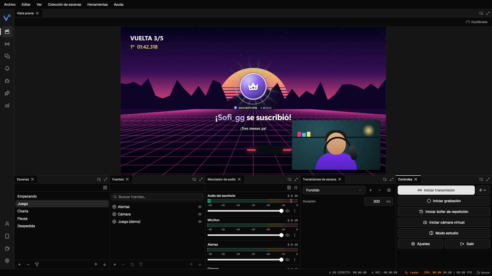

</div>

---

## ✨ Features

### 🎬 Production on the OBS Studio engine
Vexcast runs on **libobs**, the same core as OBS Studio, so capture and quality are OBS's:
- **Every OBS source**: game, window and display capture (WGC/DXGI), video devices, input, output and per-application audio, media, image, slideshow, text, color, **browser (CEF)** and nested scenes.
- **Every option of every source, filter and encoder**: the UI is generated from OBS's real properties.
- **Filters**: chroma key, color correction, crop/pad, mask, LUT, sharpen, scroll, scale, delay, gain, compressor, limiter, noise gate, noise suppression…
- **An OBS-style editor**: move, resize keeping the aspect ratio (Shift for free), crop with Alt, edge snapping, rotation, bounding boxes, alignment, "Edit transform", fit/stretch/center, flip and rotate.
- **Scenes, groups, studio mode, transitions** (cut, fade, slide, swipe, stinger, luma wipe…) and per-item show/hide transitions.
- **Audio mixer** with per-channel meters, monitoring, sync offset, balance, mono and 6 tracks.
- **Hardware encoders** (NVENC H.264/HEVC/AV1, AMF, QuickSync) and x264/SVT-AV1 with all their options.
- **Recording** (hybrid MP4, MKV, MOV…), pause, file splitting, **replay buffer**, **virtual camera**, screenshots and **global hotkeys**.
- **Preview quality** from a light 640 px / 15 fps up to full canvas resolution at 60 fps.
- **OBS-compatible scene collections**: import your OBS Studio scenes in one click.

### 📡 Free, local multistreaming
- Stream to **Twitch, YouTube, Kick, TikTok, Facebook, X, Trovo** or any RTMP(S)/SRT server, all at once.
- **A single encode** shared by every destination, to save CPU and GPU.
- Each destination **reconnects on its own**: if one drops, the rest keep going.
- Pick the hardware encoder you have (**NVENC, QuickSync, AMF, VideoToolbox**) or let Vexcast detect it; with none, it uses x264.
- Live status of every destination: bitrate, reconnects and errors.

### 💬 Unified chat and bot
- **Twitch, YouTube and Kick** in a single chat with badges and colors.
- Automatic alerts for **subs, gifts, raids, bits, Super Chats, members** and **Ko-fi donations**.
- **Bot** with custom commands (`{user}`, `{uptime}`, `{channel}`, `{args}`), cooldowns and timed messages.
- **Moderation**: blocked words and optional moderation with local AI.

### 🔔 Alerts and widgets
- **Alerts, chat, donation goal, recent events and captions** widgets: animated, transparent pages that also work in OBS.
- Per-alert-type templates, animations, sound and **TTS voice mixed straight into the stream**.

### 🤖 Local AI (free and private)
- **TTS**: system voices, **Piper** or any OpenAI-compatible server (**Kokoro**, LocalAI…).
- **AI co-host** with **Ollama**, LM Studio or llama.cpp: answers the chat by text and voice.
- **Live captions** with Whisper (faster-whisper-server, speaches, whisper.cpp) and **automatic translation**.
- Everything runs on your PC. More in [docs/AI.md](docs/AI.md).

### 📱 Phone remote and camera
- The **Vexcast Remote** app for Android and iOS: scan a QR code and control scenes, audio, streaming, recording, chat and alerts over your local network.
- **Use your phone as a camera**: it streams straight to your PC over Wi-Fi (or over the internet when you're away), with live camera switching, mirror, rotation, zoom, torch, focus, exposure and quality settings.

### 🔄 Always up to date
- **Built-in updater**: Vexcast finds new versions, shows what's new and updates in one click.

---

## 📸 Screenshots

### Desktop

| | |
|---|---|
| 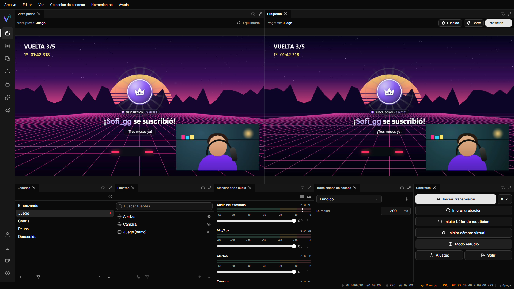 | 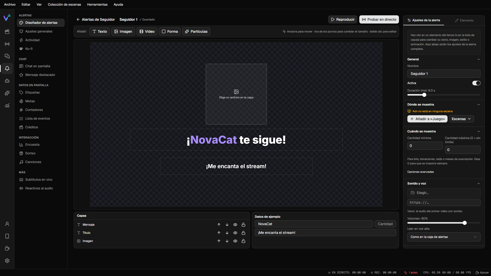 |
| Studio mode: preview and program side by side | Alert designer |
| 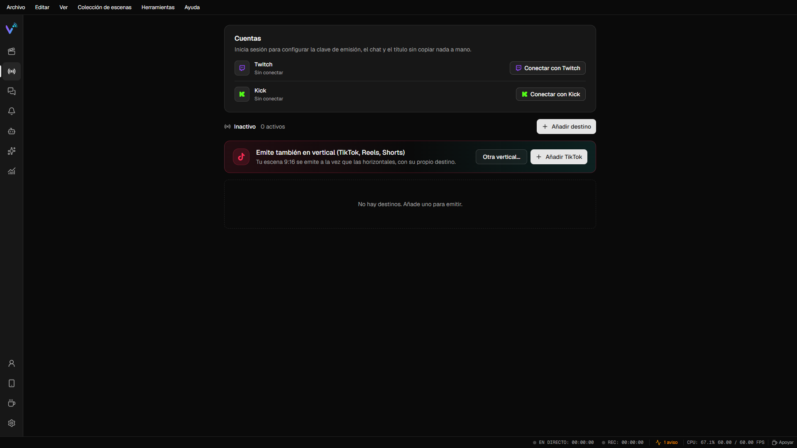 | 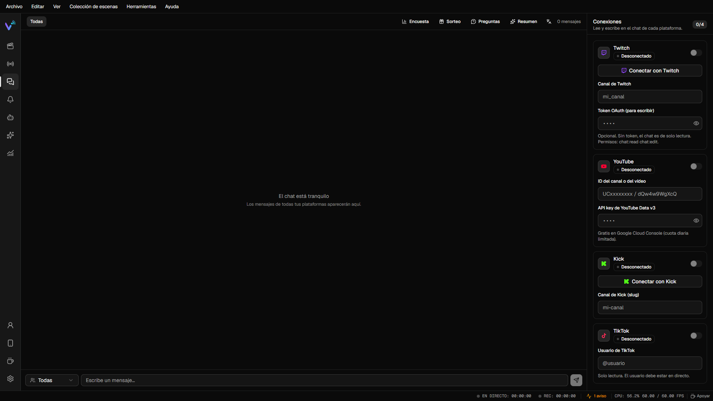 |
| Destinations and linked accounts | Unified chat |
| 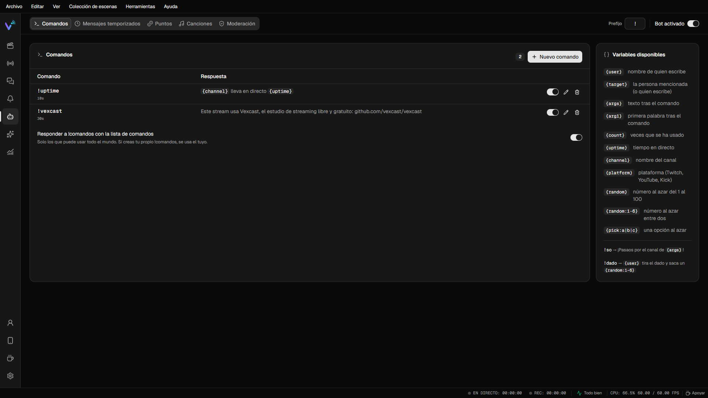 | 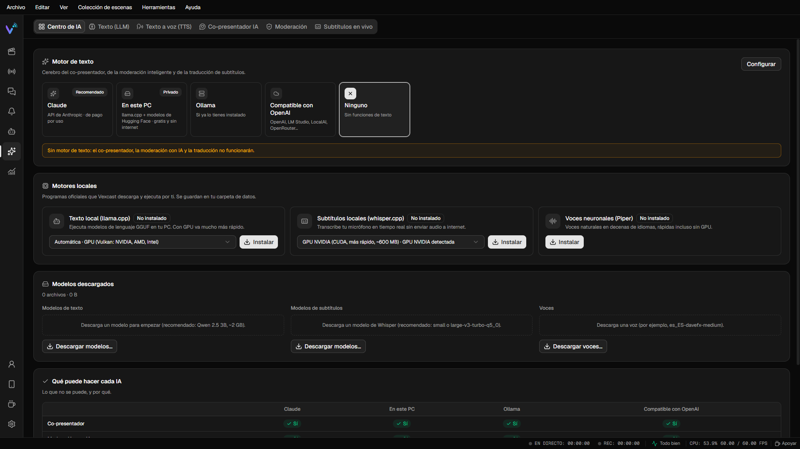 |
| Chat bot | AI hub |
| 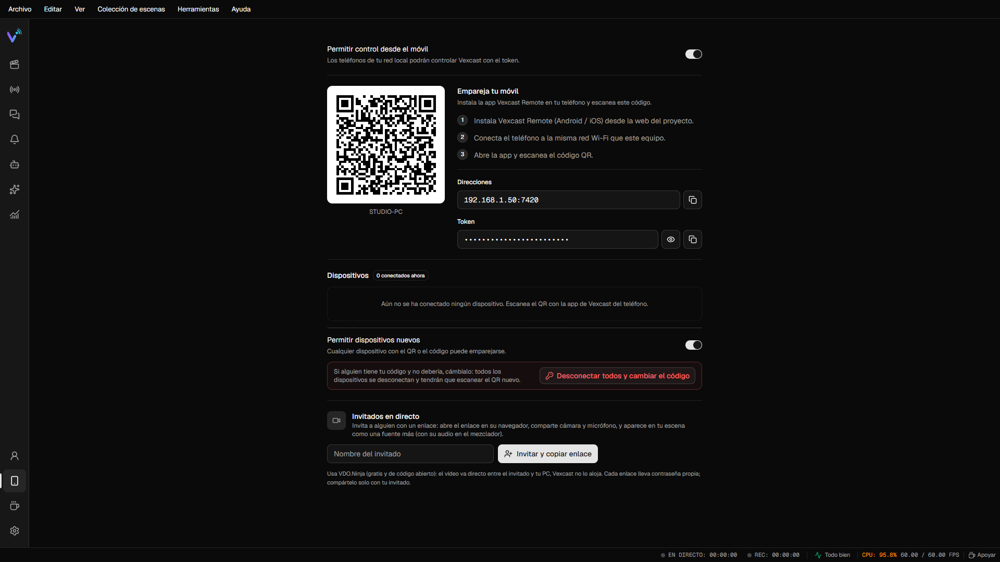 | 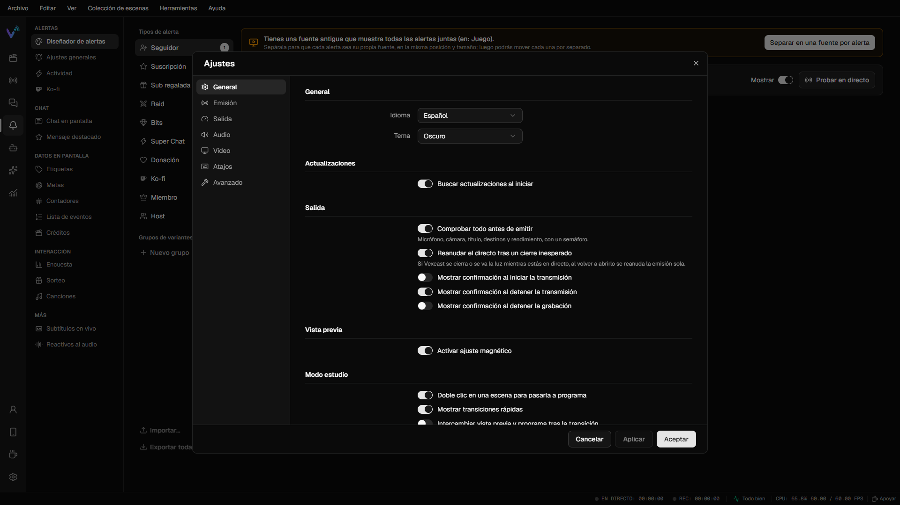 |
| Phone pairing | Settings |
| 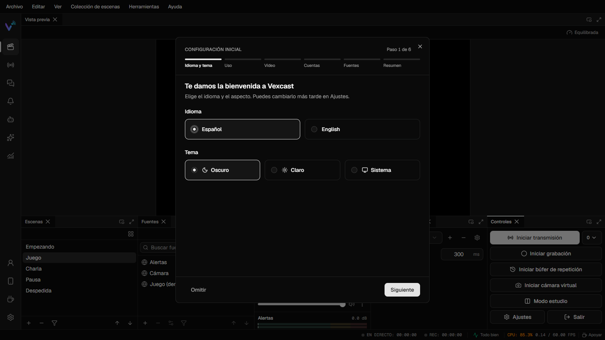 | 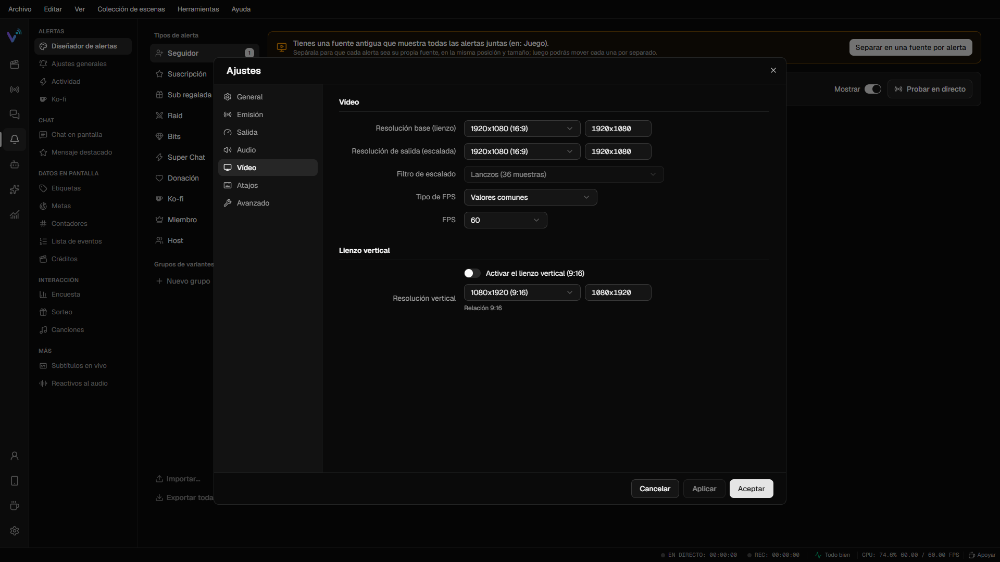 |
| First-run wizard | Video settings and vertical canvas |

### Vexcast Remote (mobile)

| | | | |
|---|---|---|---|
| 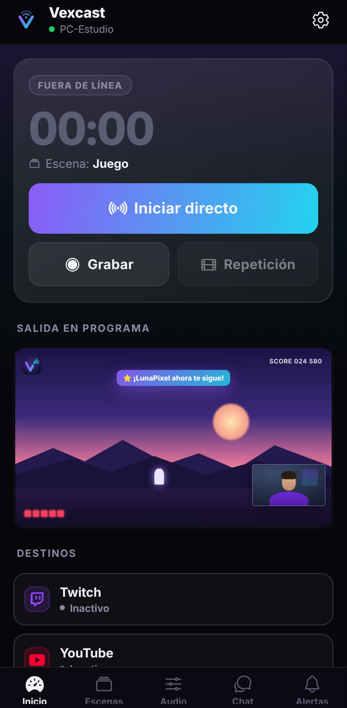 | 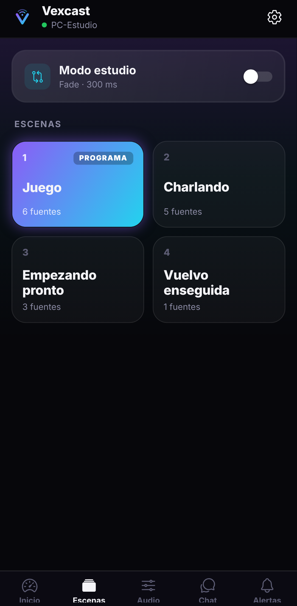 | 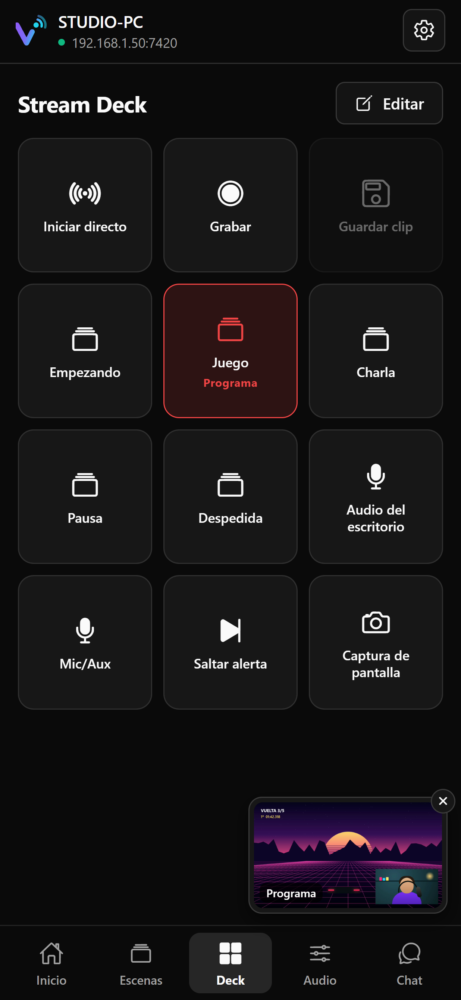 | 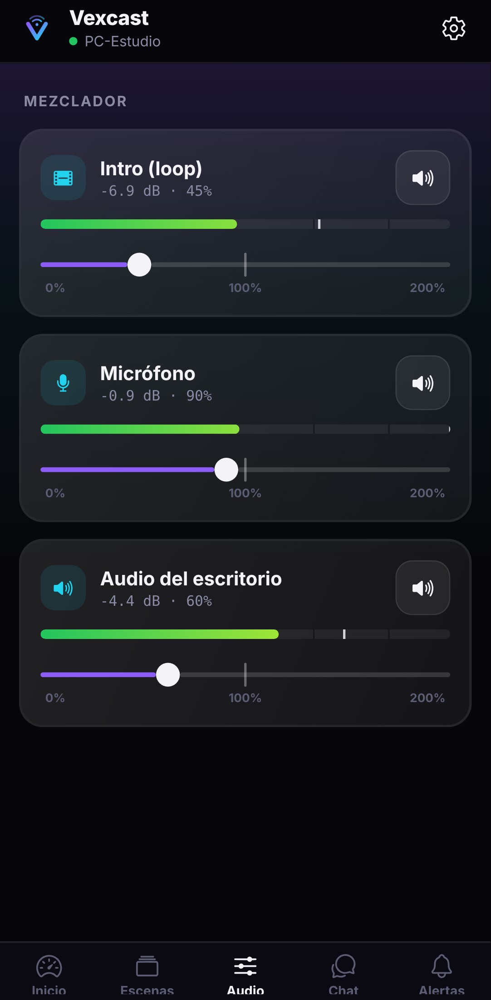 |
| Dashboard | Scenes | Stream Deck | Audio |
| 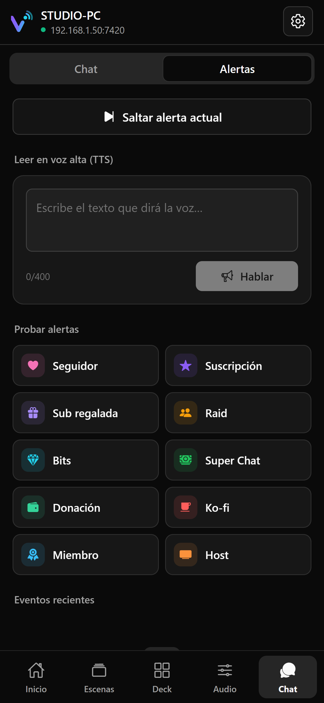 | 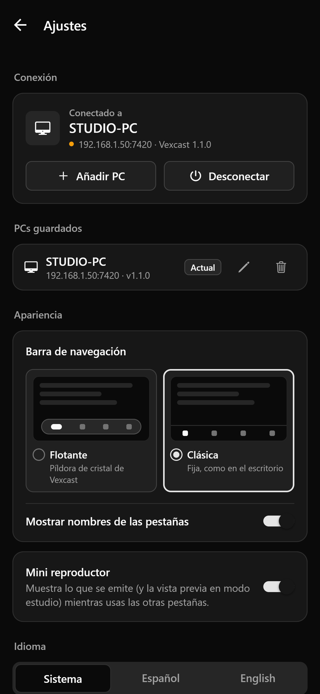 | 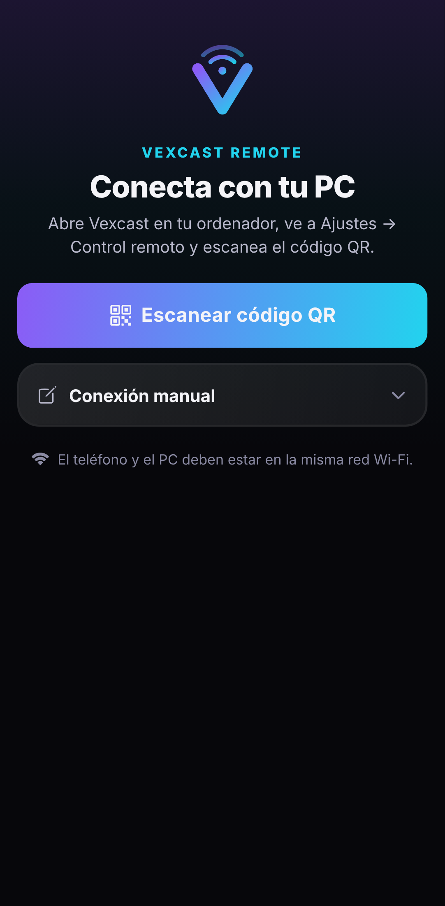 | 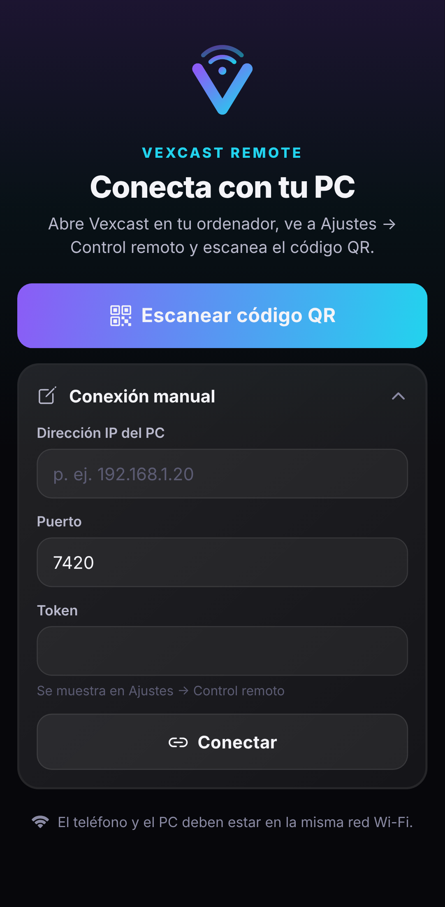 |
| Alerts and TTS | Settings | Pairing | Manual connection |

---

## 📥 Installation

Download the latest version from **[Releases](https://github.com/vexcast/vexcast/releases/latest)**:

| System | File | Notes |
|---|---|---|
| Windows 10/11 (64-bit) | `Vexcast_x.y.z_x64-setup.exe` | Includes the OBS Studio 32.1 engine |
| macOS 12+ (Apple Silicon) | `Vexcast_x.y.z_aarch64.dmg` | Includes the OBS Studio 32.1 engine |
| Linux (Ubuntu/Debian, 64-bit) | `Vexcast_x.y.z_amd64.deb` | Uses OBS Studio 32 from its official PPA |
| Android | `vexcast-remote-x.y.z.apk` | Remote control app |
| Headless server | `vexcast-server-windows-x64.zip` | Open `http://localhost:7420/app/` |

> **Windows SmartScreen**: the installer isn't signed yet; click "More info → Run anyway".
> **macOS**: the app isn't notarized yet. The first time, open it, then go to **System Settings → Privacy & Security** and click **Open Anyway**.
> **Linux**: add the OBS PPA first (`sudo add-apt-repository ppa:obsproject/obs-studio`), then `sudo apt install ./Vexcast_x.y.z_amd64.deb`. Updates are manual on Linux for now.

The interface is in Spanish by default and also available in English.

---

## 🚀 Getting started

1. Open Vexcast. You'll see a sample scene.
2. **Sources → Add**: pick your display, webcam, microphone and desktop audio.
3. **Multistream → Add destination**: choose the platform and paste your stream key.
4. Click **Start streaming**. 🎉
5. (Optional) **Settings → Remote control**: scan the QR code with the phone app.
6. (Optional) **Local AI**: turn on the voice, the co-host or captions. See the [guide](docs/AI.md).

---

## 🏗️ Architecture

```
vexcast/
├── crates/vexcast-core     # Rust: libobs engine (OBS), multistream, chat, alerts, AI, API
├── crates/vexcast-server   # Headless binary (core + web UI)
├── apps/desktop            # React + Tailwind (UI) and src-tauri (desktop app, Tauri 2)
├── apps/mobile             # Expo / React Native (Android/iOS remote)
├── packages/protocol       # Shared TypeScript types and client
├── packages/mock-core      # Simulated core for UI development
├── widgets                 # HTML overlays (alerts, chat, goal, events, captions, phone camera)
└── docs                    # API, local AI, releasing
```

The core exposes a **local HTTP + WebSocket API** (port 7420) used by the desktop UI, the phone app and the widgets. Anyone can build integrations on it (Stream Deck, bots, etc.). The reference is in [docs/API.md](docs/API.md).

## 🛠️ Development

Requirements and first steps are in [docs/DEVELOPMENT.md](docs/DEVELOPMENT.md). You need Rust, Node 22 + pnpm and the OBS runtime, which `node scripts/fetch-obs-runtime.mjs` downloads.

Install the dependencies:

```bash
pnpm install
```

Run the desktop app in development mode:

```bash
pnpm tauri dev
```

If you only want the core with the web UI, build the UI and start the headless server (open `http://localhost:7420/app/`):

```bash
pnpm build:ui
```

```bash
cargo run --release -p vexcast-server -- --ui-dir apps/desktop/dist
```

To work on the UI without building Rust, use the simulated core:

```bash
pnpm --filter @vexcast/mock-core start
```

```bash
pnpm dev
```

For the phone app (scan the QR code with Expo Go):

```bash
pnpm mobile
```

To run the tests:

```bash
cargo test -p vexcast-core
```

```bash
pnpm typecheck
```

How releases are published is described in [docs/RELEASING.md](docs/RELEASING.md).

---

## ☕ Support the project

Vexcast is and will stay **100% free and open source**. If you find it useful, you can buy me a coffee:

<a href="https://ko-fi.com/emanueldev"></a>

Leaving a ⭐, reporting bugs or contributing code, translations or widgets helps a lot too.

## 📄 License

[GPL-3.0-or-later](LICENSE) © Vexcast contributors.
