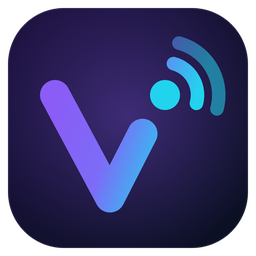

<div align="center">



# Vexcast

**El estudio de streaming libre, gratuito y local.**
Escenas, multistreaming, chat unificado, alertas, bot e IA local — sin suscripciones, sin cuentas, sin telemetría.

[](https://github.com/vexcast/vexcast/actions/workflows/ci.yml)
[](LICENSE)
[](https://ko-fi.com/emanueldev)

[Descargar](https://github.com/vexcast/vexcast/releases/latest) · [Funciones](#-funciones) · [IA local](docs/AI.md) · [API](docs/API.md) · [English](#english)


</div>

---

## ✨ Funciones

### 🎬 Producción con el motor de OBS Studio
Vexcast usa **libobs**, el mismo núcleo que OBS Studio, así que la captura y la calidad son las de OBS:
- **Todas las fuentes de OBS**: captura de juego, ventana y pantalla (WGC/DXGI), dispositivos de video, audio de entrada, salida y por aplicación, multimedia, imagen, presentación, texto, color, **navegador (CEF)** y escenas anidadas.
- **Todas las opciones de cada fuente, filtro y codificador**: la interfaz se genera desde las propiedades reales de OBS.
- **Filtros**: croma, corrección de color, recorte/relleno, máscara, LUT, nitidez, desplazamiento, escala, retardo, ganancia, compresor, limitador, puerta de ruido, supresión de ruido…
- **Editor como el de OBS**: mover, redimensionar manteniendo la proporción (Shift para libre), recortar con Alt, ajuste a bordes, rotación, cajas delimitadoras, alineación, «Editar transformación», ajustar/estirar/centrar, voltear y rotar.
- **Escenas, grupos, modo estudio, transiciones** (corte, fundido, deslizar, barrido, stinger, luma wipe…) y transiciones de mostrar/ocultar por elemento.
- **Mezclador de audio** con medidores por canal, monitorización, sincronización, balance, mono y 6 pistas.
- **Codificadores por hardware** (NVENC H.264/HEVC/AV1, AMF, QuickSync) y x264/SVT-AV1 con todas sus opciones.
- **Grabación** (MP4 híbrido, MKV, MOV…), pausa, división de archivos, **búfer de repetición**, **cámara virtual**, capturas de pantalla y **atajos de teclado globales**.
- **Colecciones de escenas compatibles con OBS**: importa tus escenas de OBS Studio con un clic.

### 📡 Multistreaming gratis y local
- Emite a **Twitch, YouTube, Kick, TikTok, Facebook, X, Trovo** o cualquier servidor RTMP(S)/SRT, todo a la vez.
- **Una sola codificación** compartida por todos los destinos, para ahorrar CPU y GPU.
- Cada destino **se reconecta por su cuenta**: si uno se cae, los demás siguen.
- Elige el codificador por hardware que tengas (**NVENC, QuickSync, AMF, VideoToolbox**) o deja que Vexcast lo detecte solo; si no hay ninguno, usa x264.
- Estado en vivo de cada destino: bitrate, reconexiones y errores.

### 💬 Chat unificado y bot
- **Twitch, YouTube y Kick** en un solo chat con insignias y colores.
- Alertas automáticas de **subs, regalos, raids, bits, superchats, miembros** y **donaciones de Ko-fi**.
- **Bot** con comandos personalizados (`{user}`, `{uptime}`, `{channel}`, `{args}`), enfriamientos y mensajes temporizados.
- **Moderación**: palabras bloqueadas y moderación opcional con IA local.

### 🔔 Alertas y widgets
- Widgets de **alertas, chat, meta de donaciones, eventos recientes y subtítulos**. Son páginas animadas y transparentes que también funcionan en OBS.
- Plantillas por tipo de alerta, animaciones, sonido y **voz TTS mezclada directamente en el stream**.

### 🤖 IA local (gratis y privada)
- **TTS**: voces del sistema, **Piper** o cualquier servidor compatible con OpenAI (**Kokoro**, LocalAI…).
- **Co-host con IA** usando **Ollama**, LM Studio o llama.cpp: responde al chat por texto y por voz.
- **Subtítulos en vivo** con Whisper (faster-whisper-server, speaches, whisper.cpp) y **traducción automática**.
- Todo corre en tu PC. Más información en [docs/AI.md](docs/AI.md).

### 📱 Control desde el móvil
- App **Vexcast Remote** para Android e iOS: escanea un QR y controla escenas, audio, directo, grabación, chat y alertas desde tu red local.

### 🔄 Siempre al día
- **Actualizador integrado**: Vexcast detecta las versiones nuevas, muestra las novedades y se actualiza con un clic.

---

## 📥 Instalación

Descarga la última versión desde **[Releases](https://github.com/vexcast/vexcast/releases/latest)**:

| Sistema | Archivo | Notas |
|---|---|---|
| Windows 10/11 (64 bits) | `Vexcast_x.y.z_x64-setup.exe` | Incluye el motor de OBS Studio 32.1 |
| Android | `vexcast-remote-x.y.z.apk` | App de control remoto |
| Servidor sin interfaz | `vexcast-server-windows-x64.zip` | Abre `http://localhost:7420/app/` |

> **macOS y Linux** llegarán más adelante: el motor ya compila contra libobs, falta empaquetarlo.
> **Windows SmartScreen**: el instalador aún no está firmado; pulsa «Más información → Ejecutar de todas formas».

---

## 🚀 Primeros pasos

1. Abre Vexcast. Verás una escena de ejemplo.
2. **Fuentes → Añadir**: elige tu pantalla, la webcam, el micrófono y el audio del escritorio.
3. **Multistream → Añadir destino**: elige la plataforma y pega tu clave de transmisión.
4. Pulsa **Iniciar directo**. 🎉
5. (Opcional) **Ajustes → Control remoto**: escanea el QR con la app móvil.
6. (Opcional) **IA local**: activa la voz, el co-host o los subtítulos. Consulta la [guía](docs/AI.md).

---

## 🏗️ Arquitectura

```
vexcast/
├── crates/vexcast-core     # Rust: motor libobs (OBS), multistream, chat, alertas, IA, API
├── crates/vexcast-server   # Binario sin interfaz (núcleo + interfaz web)
├── apps/desktop            # React + Tailwind (interfaz) y src-tauri (app de escritorio, Tauri 2)
├── apps/mobile             # Expo / React Native (control remoto Android/iOS)
├── packages/protocol       # Tipos y cliente TypeScript compartidos
├── packages/mock-core      # Núcleo simulado para desarrollar la interfaz
├── widgets                 # Overlays HTML (alertas, chat, meta, eventos, subtítulos)
└── docs                    # API, IA local, publicación
```

El núcleo expone una **API HTTP + WebSocket local** (puerto 7420) que usan la interfaz de escritorio, la app móvil y los widgets. Cualquiera puede construir integraciones (Stream Deck, bots, etc.). La referencia está en [docs/API.md](docs/API.md).

## 🛠️ Desarrollo

Requisitos y primeros pasos en [docs/DEVELOPMENT.md](docs/DEVELOPMENT.md). Necesitas Rust, Node 22 + pnpm y el runtime de OBS: lo descarga `node scripts/fetch-obs-runtime.mjs`.

Instala las dependencias:

```bash
pnpm install
```

Arranca la app de escritorio en modo desarrollo:

```bash
pnpm tauri dev
```

Si solo quieres el núcleo con la interfaz web, compila la interfaz y arranca el servidor sin interfaz (abre `http://localhost:7420/app/`):

```bash
pnpm build:ui
```

```bash
cargo run --release -p vexcast-server -- --ui-dir apps/desktop/dist
```

Para trabajar en la interfaz sin compilar Rust, usa el núcleo simulado:

```bash
pnpm --filter @vexcast/mock-core start
```

```bash
pnpm dev
```

Para la app móvil (escanea el QR con Expo Go):

```bash
pnpm mobile
```

Para pasar los tests:

```bash
cargo test -p vexcast-core
```

```bash
pnpm typecheck
```

El proceso para publicar versiones está en [docs/RELEASING.md](docs/RELEASING.md).

---

## ☕ Apoya el proyecto

Vexcast es y será **100 % gratuito y libre**. Si te resulta útil, puedes invitarme a un café:

<a href="https://ko-fi.com/emanueldev"></a>

También ayuda mucho dejar una ⭐, reportar errores o contribuir con código, traducciones o widgets.

## 📄 Licencia

[GPL-3.0-or-later](LICENSE) © Vexcast contributors.

---

## English

**Vexcast** is a free, open-source, local-first live-streaming studio, an alternative to Streamlabs Desktop:

- Scenes and sources, including transparent browser sources.
- A simultaneous vertical canvas.
- Multistreaming to Twitch, YouTube, Kick, TikTok and more with a single encode.
- Unified chat, alerts and widgets, and a chat bot.
- Local AI: TTS, an LLM co-host, moderation and live captions.
- A phone remote app and a built-in auto-updater.

No subscriptions, no accounts, no telemetry. Download it from [Releases](https://github.com/vexcast/vexcast/releases/latest). Support the project on [Ko-fi](https://ko-fi.com/emanueldev).
